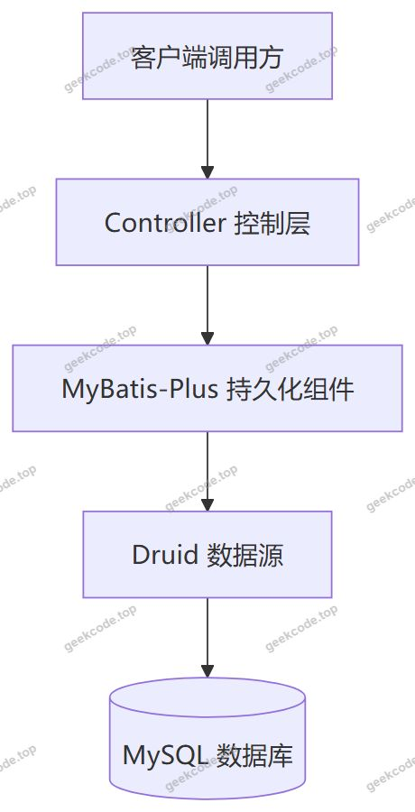
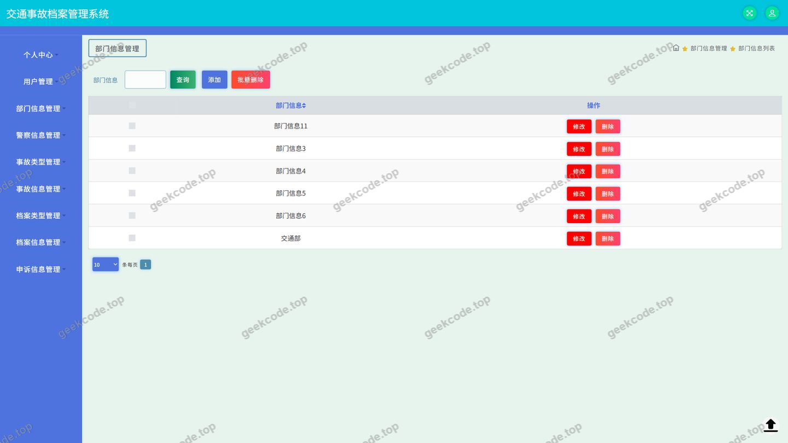
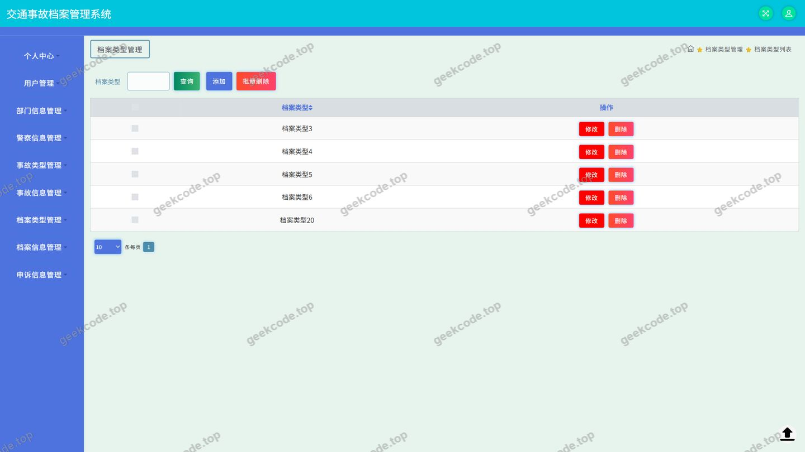
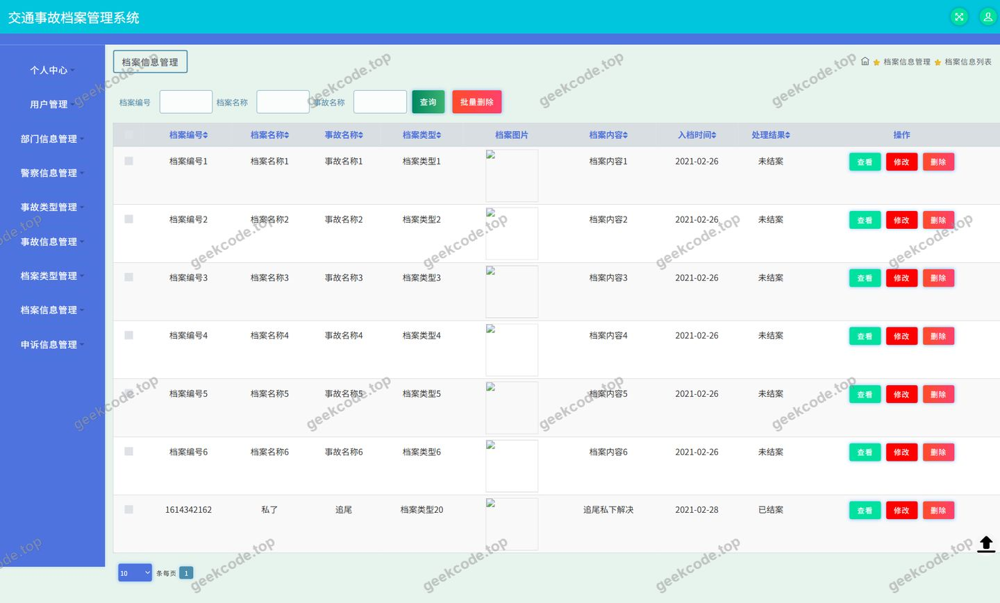
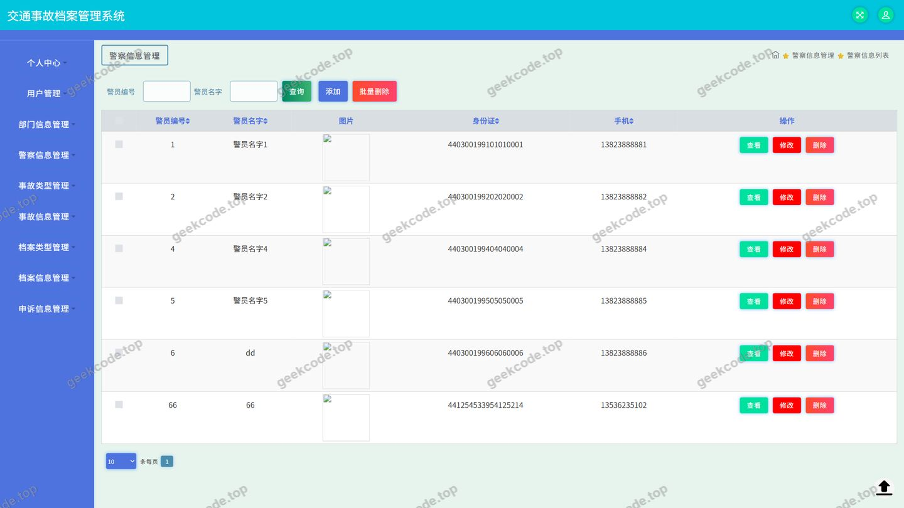
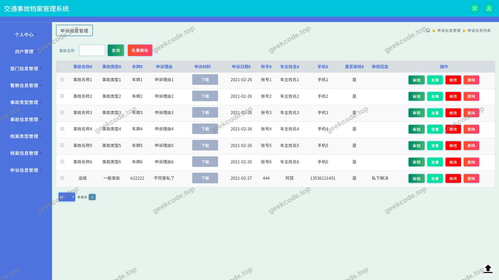
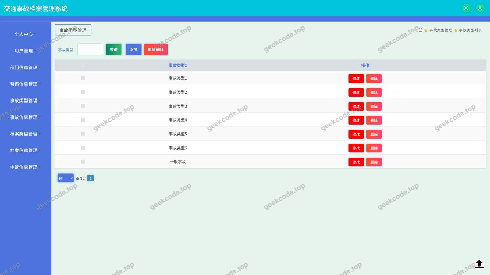
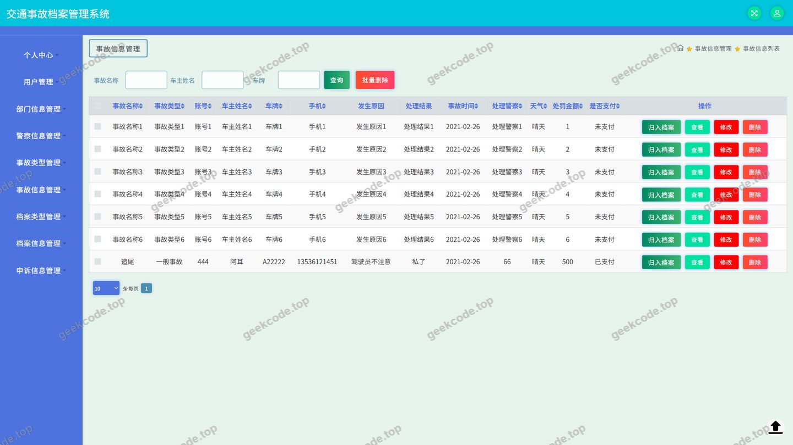
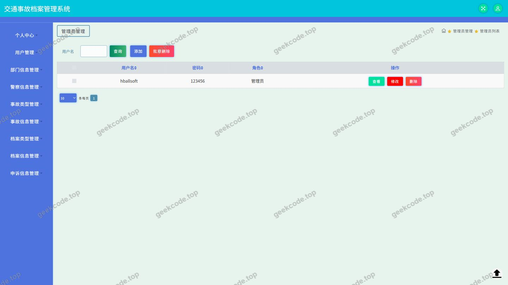

# java项目ssm交通档案管理系统java毕业设计

> 🎓 **计算机毕业设计 · java项目ssm交通档案管理系统java毕业设计**
>
> 本仓库只放**项目介绍 + 运行截图**（截图是站点带水印的原图，存在仓库 `images/` 里）。
>
> 👉 **完整可运行源码 / 数据库脚本 / 部署文档：[点我获取](https://geekcode.top/archives/java%E9%A1%B9%E7%9B%AEssm%E4%BA%A4%E9%80%9A%E6%A1%A3%E6%A1%88%E7%AE%A1%E7%90%86%E7%B3%BB%E7%BB%9Fjava%E6%AF%95%E4%B8%9A%E8%AE%BE%E8%AE%A1?utm_source=github)**
>
> 💬 咨询微信：**ir9372**　|　🌐 更多项目：[极客代码 geekcode.top](https://geekcode.top/?utm_source=github)
>
> 📌 项目详情页：<https://geekcode.top/archives/java%E9%A1%B9%E7%9B%AEssm%E4%BA%A4%E9%80%9A%E6%A1%A3%E6%A1%88%E7%AE%A1%E7%90%86%E7%B3%BB%E7%BB%9Fjava%E6%AF%95%E4%B8%9A%E8%AE%BE%E8%AE%A1?utm_source=github>

<table><td width="230" align="center"> <b>扫码加微信 ir9372</b></td><td valign="middle">📦 源码 = 项目介绍 + 全部运行截图 + 数据库 + 部署文档 👉 点上方任意截图，直接跳到 <b>极客代码 geekcode.top</b> 详情页</td></table>

---

<h1>java项目_ssm交通档案管理系统_java毕业设计</h1>
<h2>项目概述</h2>

交通档案管理系统是一套面向交通管理业务领域的信息化档案管理平台，用于对交通管理工作中产生的各类档案资料及关联业务信息进行集中登记、分类维护与统一管理。系统核心功能覆盖档案信息管理、档案类型维护、事故信息与事故类型管理、警察信息管理、申诉信息管理、部门信息管理以及用户信息管理，并配套提供登录、文件处理、通用接口与配置管理等基础支撑能力。

适用人群为交通管理部门的内勤人员、档案管理员及业务数据维护人员，用于替代传统纸质或分散电子表格形式的档案台账管理方式。

技术架构方面，项目采用传统 Spring 框架体系，以 spring-webmvc 承担请求分发与控制层职责，以 spring-jdbc、spring-tx 支撑数据访问与事务管理，持久层选用 MyBatis-Plus 简化单表增删改查操作，数据源采用 Druid 连接池实现连接管理与监控。项目形态为纯 API 后端服务，对外提供接口能力，不包含前端页面与路由代码。

<h2>技术架构</h2>
<h3>整体架构</h3>

项目为纯 API 后端工程，不包含前台页面与后台页面路由代码，其职责是向调用方输出数据接口。架构分层如下：

控制层由 12 个 Controller 组成，分别承担不同业务域或基础能力的接口输出职责；持久化层由 MyBatis-Plus 提供通用 CRUD 能力与条件构造能力；数据源由 Druid 统一管理数据库连接。

<h3>核心依赖与选型理由</h3>
<table>
<thead>
<tr>
<th>依赖</th>
<th>作用</th>
<th>选型理由</th>
</tr>
</thead>
<tbody><tr>
<td>spring-web / spring-webmvc</td>
<td>提供 Web 请求分发、控制器映射与参数绑定</td>
<td>传统 Spring MVC 体系，控制层职责清晰，与现有工程配置一致</td>
</tr>
<tr>
<td>spring-context / spring-context-support / spring-beans</td>
<td>提供容器与依赖注入能力</td>
<td>支撑各层组件的装配与生命周期管理</td>
</tr>
<tr>
<td>spring-jdbc / spring-tx</td>
<td>提供 JDBC 访问基础与声明式事务支持</td>
<td>为数据访问与业务一致性提供底层保障</td>
</tr>
<tr>
<td>spring-aop</td>
<td>提供面向切面能力</td>
<td>用于事务、日志等横切逻辑的织入</td>
</tr>
<tr>
<td>spring-core</td>
<td>框架核心工具与基础类型支撑</td>
<td>Spring 体系运行的基础依赖</td>
</tr>
<tr>
<td>MyBatis-Plus</td>
<td>持久层框架</td>
<td>在 MyBatis 基础上提供通用 CRUD 与条件构造，减少重复 SQL 编写</td>
</tr>
<tr>
<td>Druid</td>
<td>数据库连接池</td>
<td>提供连接复用与数据源监控能力</td>
</tr>
<tr>
<td>junit</td>
<td>单元测试</td>
<td>用于代码质量验证</td>
</tr>
</tbody></table>
<h3>数据库设计要点</h3>
<ul>
<li>数据库类型为 MySQL，通过 Druid 数据源接入。</li>
<li>数据表围绕业务实体组织，与业务模块一一对应，主要包括部门信息、档案类型、档案信息、警察信息、申诉信息、事故类型、事故信息、用户等主题数据。</li>
<li>实体间存在明确的类型—明细引用关系：档案类型为档案信息提供分类依据，事故类型为事故信息提供分类依据，部门信息为人员与业务数据提供组织维度。</li>
<li>持久层通过 MyBatis-Plus 完成映射与访问，具体表结构与字段定义需以工程中的实体类与 SQL 脚本为准。</li>
</ul>
<h2>功能模块</h2>

本系统为纯 API 服务，功能以接口形式对外提供。根据截图功能列表与 Controller 列表，系统功能模块如下。

<h3>基础与支撑模块</h3>
<table>
<thead>
<tr>
<th>模块</th>
<th>对应控制器</th>
<th>功能描述</th>
</tr>
</thead>
<tbody><tr>
<td>登录</td>
<td>—（对应截图功能项）</td>
<td>提供系统登录入口，用于调用方身份进入与后续业务操作</td>
</tr>
<tr>
<td>通用接口</td>
<td>CommonController</td>
<td>提供跨业务域使用的通用数据处理接口</td>
</tr>
<tr>
<td>配置管理</td>
<td>ConfigController</td>
<td>提供系统配置相关参数的读取与维护接口</td>
</tr>
<tr>
<td>文件处理</td>
<td>FileController</td>
<td>提供文件上传、下载等文件资源处理相关接口</td>
</tr>
<tr>
<td>用户接口</td>
<td>UserController</td>
<td>提供用户相关的接口能力</td>
</tr>
</tbody></table>
<h3>业务管理模块</h3>
<table>
<thead>
<tr>
<th>模块</th>
<th>对应控制器</th>
<th>功能描述</th>
</tr>
</thead>
<tbody><tr>
<td>部门信息</td>
<td>BumenxinxiController</td>
<td>维护交通管理相关的部门基础信息，为人员与业务数据提供组织维度</td>
</tr>
<tr>
<td>档案类型</td>
<td>DanganleixingController</td>
<td>维护档案的分类类型，作为档案信息的分类依据</td>
</tr>
<tr>
<td>档案信息</td>
<td>DanganxinxiController</td>
<td>对交通档案资料进行登记、查询与维护，是系统的核心业务模块</td>
</tr>
<tr>
<td>警察信息</td>
<td>JingchaxinxiController</td>
<td>维护警察人员基础信息</td>
</tr>
<tr>
<td>申诉信息</td>
<td>ShensuxinxiController</td>
<td>登记与维护申诉记录信息</td>
</tr>
<tr>
<td>事故类型</td>
<td>ShiguleixingController</td>
<td>维护事故分类类型，作为事故信息的分类依据</td>
</tr>
<tr>
<td>事故信息</td>
<td>ShiguxinxiController</td>
<td>登记与维护交通事故记录信息</td>
</tr>
<tr>
<td>用户</td>
<td>YonghuController</td>
<td>维护系统用户信息</td>
</tr>
</tbody></table>

每个业务模块均提供对应的接口，用于业务数据的录入、查询、修改与删除等操作。

<h2>用户角色与权限</h2>

根据提供的源码与配置上下文，可确认系统中存在以下与用户身份相关的组成部分：

<ul>
<li><strong>用户信息维护（YonghuController）</strong>：系统包含独立的用户信息管理模块，用于维护用户基础数据。</li>
<li><strong>用户接口（UserController）</strong>：系统包含用户相关的接口能力。</li>
<li><strong>登录功能</strong>：截图功能列表中存在登录功能项，说明系统具备身份进入环节。</li>
</ul>

关于系统中的具体角色划分（例如管理员、普通用户等）及各角色对应的功能权限矩阵，根据现有信息无法确定：所提供的 Controller 列表与依赖清单中，未包含角色定义、权限配置、菜单授权或访问控制相关的组件与配置信息，因此无法给出各角色可访问的具体功能模块清单。

从功能覆盖面看，系统对外提供的能力范围为：登录、通用接口、配置管理、文件处理、用户接口，以及部门信息、档案类型、档案信息、警察信息、申诉信息、事故类型、事故信息、用户共八类业务数据管理接口。

<h2>项目特色与创新点</h2>
<ol>
<li>
<strong>面向交通档案业务的领域建模</strong>：系统围绕交通管理实际业务组织数据模型，将档案信息与事故信息区分管理，并分别配套档案类型与事故类型作为分类维度，同时引入警察信息、部门信息作为人员与组织维度，申诉信息作为业务过程记录，形成相互关联的业务数据结构，而非孤立的单表台账。

</li>
<li>
<strong>类型—明细两级数据组织方式</strong>：档案类型与事故类型作为独立维护的基础数据模块，与档案信息、事故信息形成分类引用关系，使业务数据的分类标准可独立调整，避免分类值散落在业务记录中。

</li>
<li>
<strong>MyBatis-Plus 提升开发效率</strong>：持久层采用 MyBatis-Plus，通过其通用 CRUD 与条件构造能力减少针对单表操作的重复 SQL 编写，使控制层能够以统一的方式输出各业务模块的接口。

</li>
<li>
<strong>Druid 连接池保障数据访问稳定性</strong>：数据源采用 Druid 连接池，实现数据库连接的复用与统一管理，为多业务模块并发访问数据库提供基础支撑。

</li>
<li>
<strong>纯 API 形态便于多端接入</strong>：项目以纯 API 形式交付，不绑定具体前端实现，接口可被 Web 管理端、移动端等多种调用方复用。

</li>
</ol>
<h2>部署环境</h2>
<table>
<thead>
<tr>
<th>类别</th>
<th>要求</th>
</tr>
</thead>
<tbody><tr>
<td>运行环境</td>
<td>需具备与所用 Spring 版本兼容的 JDK 环境，具体版本号根据现有信息无法确定</td>
</tr>
<tr>
<td>数据库</td>
<td>MySQL，需提前创建数据库并导入表结构与初始数据</td>
</tr>
<tr>
<td>数据源</td>
<td>Druid 连接池，需在工程配置中提供数据库连接地址、用户名与密码</td>
</tr>
<tr>
<td>持久层</td>
<td>MyBatis-Plus，需配置实体与数据表的映射关系</td>
</tr>
<tr>
<td>构建工具</td>
<td>需具备 Maven 等依赖管理工具以解析 spring-core、spring-context、spring-context-support、spring-tx、spring-aop、spring-beans、spring-jdbc、spring-web、spring-webmvc、MyBatis-Plus、Druid、junit 等依赖</td>
</tr>
<tr>
<td>测试依赖</td>
<td>junit，用于单元测试执行</td>
</tr>
<tr>
<td>前端环境</td>
<td>项目为纯 API 后端，不包含前端工程，无需 Node.js 等前端构建环境</td>
</tr>
<tr>
<td>访问方式</td>
<td>以 HTTP 接口形式对外提供服务，通过接口调用工具或调用方系统进行访问</td>
</tr>
</tbody></table>
<h2>五、技术特性</h2>
<ul>
<li>使用 MyBatis-Plus 简化数据访问层开发</li>
</ul>
<h2>六、功能模块截图</h2>
<h3>后台管理端</h3>
<h4>页面-部门信息</h4>

<h4>页面-档案类型</h4>

<h4>页面-档案信息</h4>

<h4>页面-登录</h4>

<h4>页面-警察信息</h4>

<h4>页面-申诉信息</h4>

<h4>页面-事故类型</h4>

<h4>页面-事故信息</h4>

<h4>页面-用户</h4>

---

## 获取完整源码

| 项目 | 说明 |
| --- | --- |
| 项目名 | java项目ssm交通档案管理系统java毕业设计 |
| 运行截图 | 本文 10 张（站点带水印原图，仓库 `images/` 目录） |
| 完整源码 | [https://geekcode.top/archives/java%E9%A1%B9%E7%9B%AEssm%E4%BA%A4%E9%80%9A%E6%A1%A3%E6%A1%88%E7%AE%A1%E7%90%86%E7%B3%BB%E7%BB%9Fjava%E6%AF%95%E4%B8%9A%E8%AE%BE%E8%AE%A1?utm_source=github](https://geekcode.top/archives/java%E9%A1%B9%E7%9B%AEssm%E4%BA%A4%E9%80%9A%E6%A1%A3%E6%A1%88%E7%AE%A1%E7%90%86%E7%B3%BB%E7%BB%9Fjava%E6%AF%95%E4%B8%9A%E8%AE%BE%E8%AE%A1?utm_source=github) |
| 咨询微信 | **ir9372**（备注：jingpin-yuanma） |
| 更多项目 | [极客代码 geekcode.top](https://geekcode.top/?utm_source=github) |

> 需要源码、部署、改配置、跑不起来等问题，加微信 ir9372 沟通，说明项目名即可。
